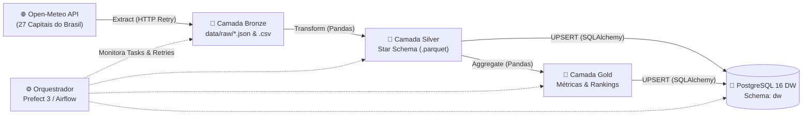
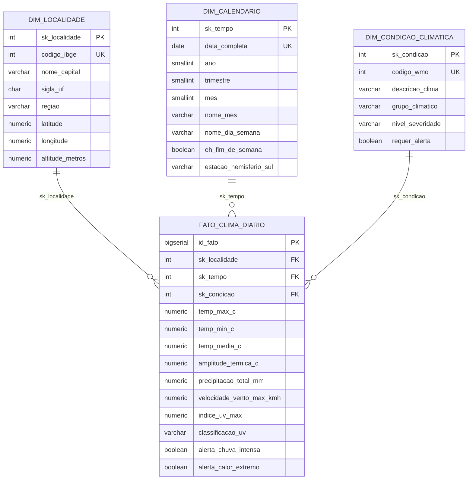

# 🌦️ Pipeline de Engenharia de Dados: Inteligência Climática das Capitais Brasileiras

[](https://www.python.org/)
[](https://pandas.pydata.org/)
[](https://www.postgresql.org/)
[](https://www.prefect.io/)
[](https://airflow.apache.org/)
[](https://www.docker.com/)

Pipeline completo de **Engenharia de Dados (ETL/ELT)** que extrai séries temporais meteorológicas das **27 capitais brasileiras** via API pública (**Open-Meteo**), realiza limpeza, validação de qualidade e enriquecimento com **Python (Pandas)**, estrutura um **Data Warehouse Dimensional (Star Schema)** no **PostgreSQL 16** em container **Docker** e calcula **métricas analíticas agregadas (Camada Gold)** sob orquestração do **Prefect 3** (com DAG equivalente para **Apache Airflow**).

---

## 🎯 Destaques para Portfólio de Engenharia de Dados

- **Extração Resiliente de API Pública (`Bronze`):** Coleta em lote na API [Open-Meteo](https://open-meteo.com/) sem necessidade de chave privada, com política de *Retry + Exponential Backoff* e persistência bruta auditável (`JSON` e `CSV`).
- **Processamento, Qualidade e Padronização (`Silver`):** Deduplicação por chave natural `(codigo_ibge, data_medicao)`, validação de consistência física (`temp_max >= temp_min`), classificação do Índice UV (padrão OMS), cálculo de amplitude térmica e detecção automática de alertas de chuva intensa e calor extremo.
- **Modelagem Dimensional de Kimball (`Star Schema`):** Separação clara entre Tabela Fato (`dw.fato_clima_diario`) e Tabelas Dimensão (`dw.dim_localidade`, `dw.dim_calendario`, `dw.dim_condicao_climatica`) com chaves substitutas (*Surrogate Keys*) e integridade referencial.
- **Carga Idempotente no PostgreSQL (`UPSERT`):** Implementação de `INSERT ... ON CONFLICT DO UPDATE` via SQLAlchemy 2.0, permitindo reexecuções (*reruns/backfills*) sem duplicar dados.
- **Métricas Agregadas (`Camada Gold / Data Marts`):** Tabelas analíticas consolidadas por macrorregião brasileira (`dw.agg_metricas_regionais`) e ranking climático das capitais (`dw.agg_resumo_capitais`), além de relatório executivo automático em Markdown e arquivos colunares **Parquet**.
- **Orquestração Moderna em Docker:** Fluxo instrumentado com **Prefect 3** (`src/orchestration/prefect_flow.py`) + servidor UI em container Docker e DAG equivalente para **Apache Airflow** (`dags/airflow_clima_dw_dag.py`).

---

## 🏗️ Arquitetura do Pipeline



---

## 📐 Modelagem Dimensional (Star Schema)

A documentação completa da modelagem dimensional, granularidade, estratégia SCD e dicionário de dados encontra-se em [`docs/modelagem_dimensional.md`](docs/modelagem_dimensional.md).



### Resumo das Tabelas do Data Warehouse (`schema dw`)

| Tabela / Objeto | Camada | Tipo | Granularidade | Chave de Conflito (Upsert) |
| :--- | :--- | :--- | :--- | :--- |
| `dw.dim_localidade` | Silver / DW | Dimensão | 1 linha por capital brasileira (27 capitais) | `sk_localidade` |
| `dw.dim_calendario` | Silver / DW | Dimensão | 1 linha por data civil (`YYYYMMDD`) | `sk_tempo` |
| `dw.dim_condicao_climatica` | Silver / DW | Dimensão | 1 linha por código meteorológico WMO | `sk_condicao` |
| `dw.fato_clima_diario` | Silver / DW | Fato | 1 medição diária por capital e data | `(sk_localidade, sk_tempo)` |
| `dw.agg_metricas_regionais` | Gold / Mart | Agregada | 1 linha por macrorregião do Brasil (5 regiões) | `regiao` |
| `dw.agg_resumo_capitais` | Gold / Mart | Agregada | 1 linha consolidada por capital + rankings | `codigo_ibge` |
| `dw.vw_analise_climatica_completa` | Gold / BI | View SQL | Visão desnormalizada pronta para Power BI / Metabase | — |

---

## 📂 Estrutura do Projeto

```text
.
├── .github/workflows/ci.yml          # Pipeline CI (Pytest + PostgreSQL 16 Service Container)
├── dags/
│   └── airflow_clima_dw_dag.py       # DAG equivalente para Apache Airflow 2.x (TaskFlow API)
├── data/
│   ├── raw/                          # Camada Bronze (JSON bruto da API e CSV inicial)
│   ├── processed/                    # Camada Silver (Tabelas Fato e Dimensão em CSV e Parquet)
│   └── gold/                         # Camada Gold (Métricas agregadas e Relatório Executivo .md)
├── docs/
│   ├── arquitetura_pipeline.md       # Detalhamento técnico da arquitetura Medallion + DW
│   └── modelagem_dimensional.md      # Documentação completa do Star Schema e Dicionário de Dados
├── sql/
│   ├── 01_init_dw_schema.sql         # DDL de criação do schema dw, tabelas, índices e views
│   └── 02_analytical_queries.sql     # Consultas OLAP (Window Functions, Médias Móveis, Rankings)
├── src/
│   ├── config.py                     # Configurações, catálogo IBGE das 27 capitais e códigos WMO
│   ├── extract/
│   │   └── open_meteo_extractor.py   # Extração HTTP resiliente da API Open-Meteo
│   ├── transform/
│   │   └── dimensional_transformer.py# Limpeza via Pandas e modelagem Star Schema
│   ├── metrics/
│   │   └── metrics_generator.py      # Cálculo das tabelas Gold e geração de relatório executivo
│   ├── load/
│   │   └── postgres_loader.py        # Carga idempotente (UPSERT) no PostgreSQL via SQLAlchemy 2.0
│   ├── orchestration/
│   │   └── prefect_flow.py           # Fluxo de orquestração Prefect (@flow e @task com retries)
│   └── main.py                       # CLI principal com resumo executivo no terminal
├── tests/                            # Testes unitários e de integridade referencial (Pytest)
├── Dockerfile                        # Imagem Docker da aplicação Python
├── docker-compose.yml                # Stack completa: PostgreSQL 16 + Prefect Server + Pipeline
├── Makefile                          # Atalhos de automação (make up, make run, make test)
└── requirements.txt                  # Dependências Python
```

---

## 🚀 Como Executar o Projeto

### Opção 1: Execução Completa com Docker Compose (Recomendado)

Sobe o banco **PostgreSQL 16** (já inicializando o schema `dw`), o **Prefect Server UI** (porta `4200`) e executa o container do pipeline ETL:

```bash
# 1. Subir toda a infraestrutura e rodar o pipeline
docker compose up --build -d

# 2. Acompanhar os logs da execução do pipeline
docker compose logs -f etl-pipeline

# 3. Consultar as métricas agregadas diretamente no PostgreSQL
docker exec -it clima_postgres_dw psql -U dw_user -d clima_dw -c \
  "SELECT regiao, qtd_capitais, temp_media_regional_c, precipitacao_acumulada_mm, dias_com_alerta_chuva FROM dw.agg_metricas_regionais ORDER BY temp_media_regional_c DESC;"
```

- **Prefect Orchestrator UI:** disponível em `http://localhost:4200`
- **PostgreSQL Data Warehouse:** disponível em `localhost:5432` (Database: `clima_dw`, User: `dw_user`, Password: `dw_password_2026`)

### Opção 2: Execução Local com Python

```bash
# 1. Criar ambiente virtual e instalar dependências
python3 -m venv .venv
source .venv/bin/activate
pip install -r requirements.txt

# 2. Executar o pipeline extraindo dados reais da API Open-Meteo
python -m src.main

# 3. Executar a suíte de testes automatizados
pytest -v
```

---

## 📊 Exemplo de Saída e Consultas Analíticas no Data Warehouse

Ao rodar `python -m src.main`, o pipeline exibe um resumo executivo no terminal e gera automaticamente [`docs/exemplo_relatorio_executivo.md`](docs/exemplo_relatorio_executivo.md):

```text
========================================================================================
 RESUMO EXECUTIVO DO PIPELINE DE DADOS (MEDALLION + STAR SCHEMA DW)
========================================================================================
 • Registros extraídos (Camada Bronze)     : 459
 • Dimensão Localidade (dim_localidade)    : 27 capitais
 • Dimensão Calendário (dim_calendario)    : 17 dias
 • Dimensão Condição WMO (dim_condicao)    : 20 categorias
 • Tabela Fato (fato_clima_diario)         : 459 medições
 • Carga PostgreSQL DW (UPSERT idempotente): {'dim_localidade': 27, 'dim_calendario': 17, 'dim_condicao_climatica': 20, 'fato_clima_diario': 459, 'agg_metricas_regionais': 5, 'agg_resumo_capitais': 27}

--- MÉTRICAS AGREGADAS POR MACRORREGIÃO (CAMADA GOLD) ---
      regiao  qtd_capitais  temp_media_regional_c  temp_max_absoluta_c  temp_min_absoluta_c  precipitacao_acumulada_mm  dias_com_alerta_chuva
       Norte             7                  28.62                 39.0                 20.4                      504.8                     16
    Nordeste             9                  28.04                 39.5                 23.0                      148.9                      0
Centro-Oeste             4                  24.92                 39.2                 14.5                      353.1                     11
     Sudeste             4                  21.49                 32.5                 12.5                      488.1                      9
         Sul             3                  17.41                 29.4                  9.0                      243.2                      5

--- TOP 5 CAPITAIS MAIS QUENTES NO PERÍODO ---
 ranking_temperatura nome_capital sigla_uf   regiao  temp_media_periodo_c  temp_max_periodo_c  chuva_acumulada_mm
                   1     Teresina       PI Nordeste                 31.84                39.5                 4.7
                   2    Boa Vista       RR    Norte                 31.18                39.0                26.9
                   3       Macapá       AP    Norte                 29.33                33.9                 6.6
                   4       Manaus       AM    Norte                 29.15                37.1               120.9
                   5     São Luís       MA Nordeste                 28.22                33.5                33.4
========================================================================================
```

O arquivo [`sql/02_analytical_queries.sql`](sql/02_analytical_queries.sql) contém consultas prontas utilizando *Window Functions* (`DENSE_RANK`, `AVG OVER`), médias móveis de 7 dias e agregações regionais:

```sql
-- Média móvel de 7 dias de temperatura e precipitação acumulada por capital
SELECT
    l.nome_capital,
    l.sigla_uf,
    c.data_completa,
    f.temp_media_c,
    ROUND(
        AVG(f.temp_media_c) OVER (
            PARTITION BY l.sk_localidade
            ORDER BY c.data_completa
            ROWS BETWEEN 6 PRECEDING AND CURRENT ROW
        ), 2
    ) AS media_movel_7d_temp_c
FROM dw.fato_clima_diario f
JOIN dw.dim_localidade l ON f.sk_localidade = l.sk_localidade
JOIN dw.dim_calendario c ON f.sk_tempo = c.sk_tempo
ORDER BY l.nome_capital, c.data_completa;
```
