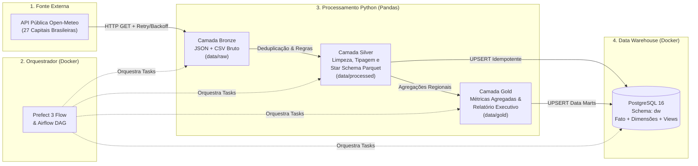

# Arquitetura do Pipeline de Engenharia de Dados

## Visão Geral (Arquitetura Medalhão + Data Warehouse)

O projeto combina o padrão **Medallion Architecture (Bronze → Silver → Gold)** em armazenamento colunar local (`Parquet`) com um **Data Warehouse Relacional (Star Schema)** no **PostgreSQL 16**, orquestrado via **Prefect 3** (e com DAG equivalente para **Apache Airflow 2.x**).

## Boas Práticas de Engenharia de Dados Implementadas

- **Resiliência na Extração:** Sessão HTTP com `Retry` e *Exponential Backoff* para lidar com instabilidades de rede e *rate limits* (`HTTP 429/5xx`), além de modo de contingência determinístico (`--offline`) para testes reproduzíveis em CI/CD.
- **Qualidade de Dados (Data Quality):** Validação física de temperaturas (`temp_max >= temp_min`), remoção de duplicidades na chave natural `(codigo_ibge, data_medicao)`, imputação de valores ausentes e bloqueio de valores negativos para grandezas absolutas (precipitação, vento, radiação UV).
- **Idempotência no Banco de Dados:** Uso de `INSERT ... ON CONFLICT DO UPDATE` (Upsert nativo do PostgreSQL via SQLAlchemy 2.0) em todas as tabelas de dimensão, fato e agregações. O pipeline pode ser executado $N$ vezes no mesmo dia sem gerar registros duplicados.
- **Armazenamento Colunar:** Persistência intermediária em formato **Apache Parquet** (`pyarrow`), garantindo compressão eficiente e preservação estrita de tipos de dados.
- **Testes Automatizados e CI/CD:** Suíte `pytest` cobrindo extração, transformação, integridade referencial do Star Schema (`FK -> PK`) e agregações Gold, integrada ao GitHub Actions com container de serviço PostgreSQL 16.
