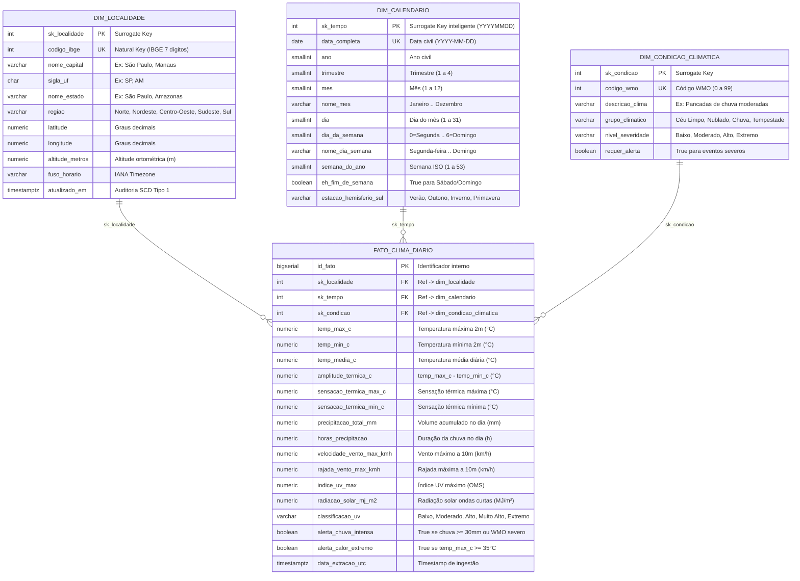

# Documentação da Modelagem Dimensional (Kimball Star Schema)

Este documento detalha a arquitetura de dados analítica implementada no **Data Warehouse de Monitoramento Climático das Capitais Brasileiras (`schema dw`)**, seguindo a metodologia de **Ralph Kimball** para bancos relacionais orientados a OLAP/BI.

---

## 1. Os 4 Passos de Kimball Aplicados ao Projeto

1. **Escolha do Processo de Negócio:** Monitoramento meteorológico diário, análise de conforto térmico, radiação UV e eventos climáticos severos nas 27 capitais estaduais brasileiras.
2. **Declaração do Grão (Granularidade):** Cada linha da tabela fato (`dw.fato_clima_diario`) representa exatamente **1 consolidação meteorológica diária para 1 capital brasileira em 1 dia civil** (`sk_localidade` + `sk_tempo`).
3. **Identificação das Dimensões:**
   - **Onde?** `dw.dim_localidade` (Geografia oficial do IBGE, UF, macrorregião, latitude, longitude, altitude).
   - **Quando?** `dw.dim_calendario` (Data, ano, trimestre, mês, dia da semana, estação do ano no Hemisfério Sul).
   - **Qual condição?** `dw.dim_condicao_climatica` (Catálogo padronizado da Organização Meteorológica Mundial - WMO).
4. **Identificação dos Fatos (Métricas):** Temperaturas (máxima, mínima, média, amplitude térmica, sensação térmica), precipitação acumulada (mm e horas), velocidade máxima e rajadas de vento (km/h), índice UV máximo, radiação solar de ondas curtas ($\text{MJ/m}^2$) e flags booleanas de alerta.

---

## 2. Diagrama Entidade-Relacionamento (Star Schema)

---

## 3. Dicionário de Dados Detalhado

### 3.1. Tabela Fato: `dw.fato_clima_diario`
- **Tipo de Tabela Fato:** *Periodic Snapshot Fact Table* (Foto diária consolidada por localidade).
- **Chave de Unicidade (Idempotência):** `UNIQUE (sk_localidade, sk_tempo)` — garante que reexecuções (*backfills* ou *reruns*) façam `UPSERT` (`ON CONFLICT DO UPDATE`) sem duplicar medições.
- **Classificação de Aditividade das Métricas:**
  - **Aditivas:** `precipitacao_total_mm`, `horas_precipitacao`, `radiacao_solar_mj_m2` (podem ser somadas em qualquer dimensão de tempo ou localidade).
  - **Não-Aditivas / Semi-Aditivas:** `temp_max_c`, `temp_min_c`, `temp_media_c`, `amplitude_termica_c`, `velocidade_vento_max_kmh`, `indice_uv_max` (devem ser agregadas via `AVG`, `MAX` ou `MIN`, nunca por `SUM`).

### 3.2. Dimensão Localidade: `dw.dim_localidade`
- **Estratégia SCD (Slowly Changing Dimension):** **SCD Tipo 1** (sobrescrita via `ON CONFLICT (sk_localidade) DO UPDATE`). Como coordenadas geográficas, código IBGE e UF das capitais são atributos estáticos/corretivos, atualizações sobrescrevem o registro mantendo a Surrogate Key (`sk_localidade`).

### 3.3. Dimensão Calendário: `dw.dim_calendario`
- **Surrogate Key Inteligente (`sk_tempo`):** Inteiro no formato `YYYYMMDD` (ex: `20261029`), permitindo *particionamento*, *indexação rápida* e *leitura humana* sem necessidade de join para filtros simples por período.
- **Atributos Sazonais:** Calcula automaticamente a estação do ano astronômica para o **Hemisfério Sul** (`Verão`, `Outono`, `Inverno`, `Primavera`) e indicadores de dias úteis vs. fim de semana.

### 3.4. Dimensão Condição Climática: `dw.dim_condicao_climatica`
- Traduz os códigos numéricos da **WMO (World Meteorological Organization)** retornados pela API Open-Meteo em agrupamentos analíticos (`Céu Limpo`, `Nublado`, `Garoa`, `Chuva`, `Pancadas de Chuva`, `Tempestade`) e níveis de severidade (`Baixo`, `Moderado`, `Alto`, `Extremo`).

---

## 4. Camada Gold (Data Marts de Métricas Agregadas)

Além do Star Schema detalhado, o pipeline materializa duas tabelas analíticas agregadas na camada Gold para consumo imediato por dashboards e relatórios executivos:

1. **`dw.agg_metricas_regionais`**: Consolida temperatura média, máxima absoluta, mínima absoluta, amplitude térmica média, precipitação acumulada, índice UV médio e contagem de alertas para cada uma das **5 macrorregiões do Brasil** (`Norte`, `Nordeste`, `Centro-Oeste`, `Sudeste`, `Sul`).
2. **`dw.agg_resumo_capitais`**: Consolida o desempenho climático das **27 capitais**, incluindo percentual de dias chuvosos (`pct_dias_chuvosos`) e rankings analíticos (`ranking_temperatura` e `ranking_precipitacao`).
